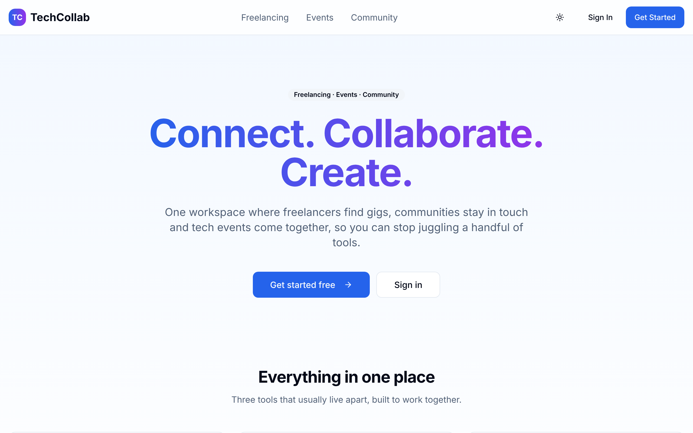
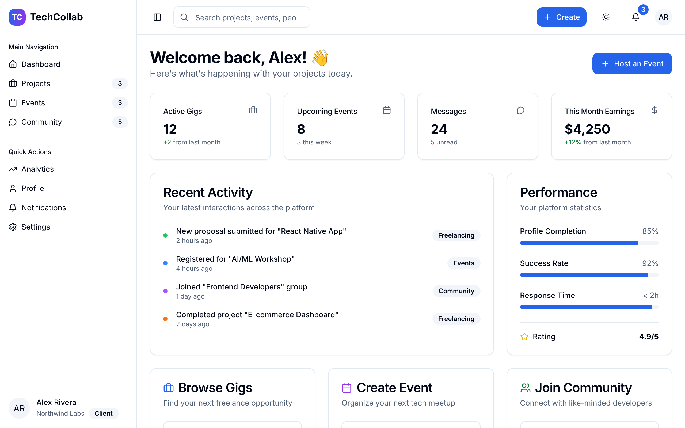
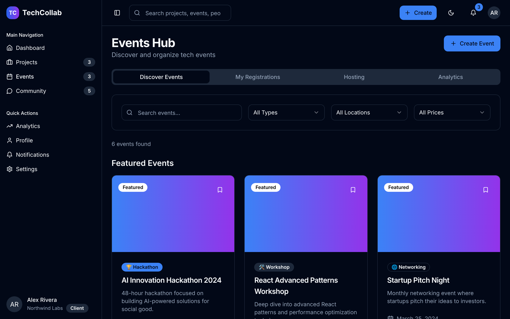
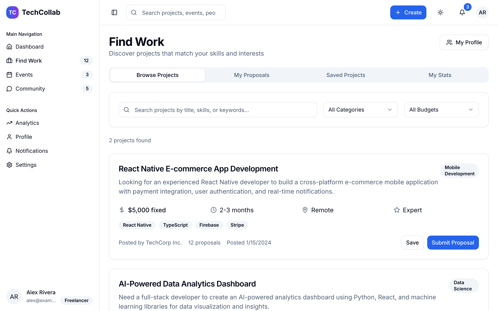
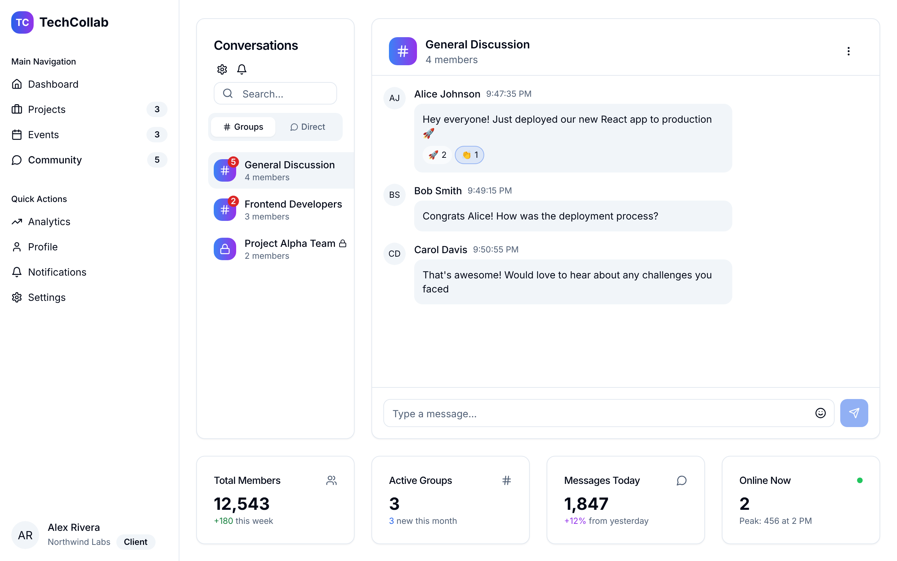
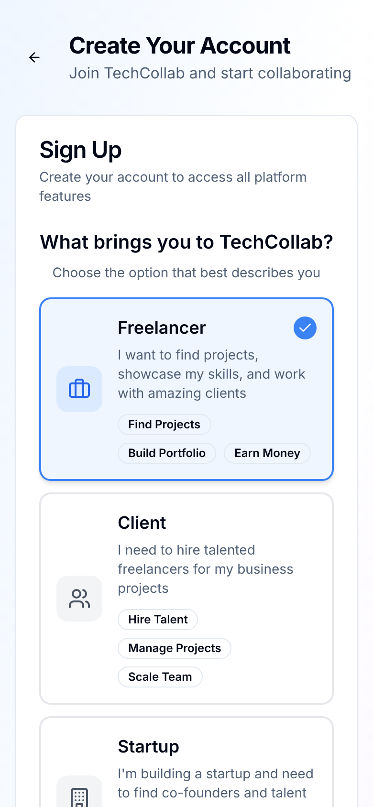
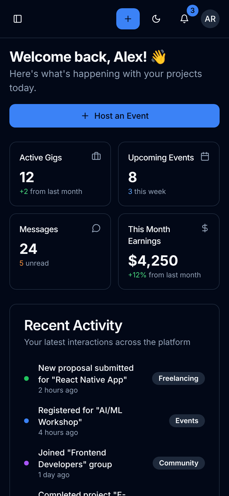
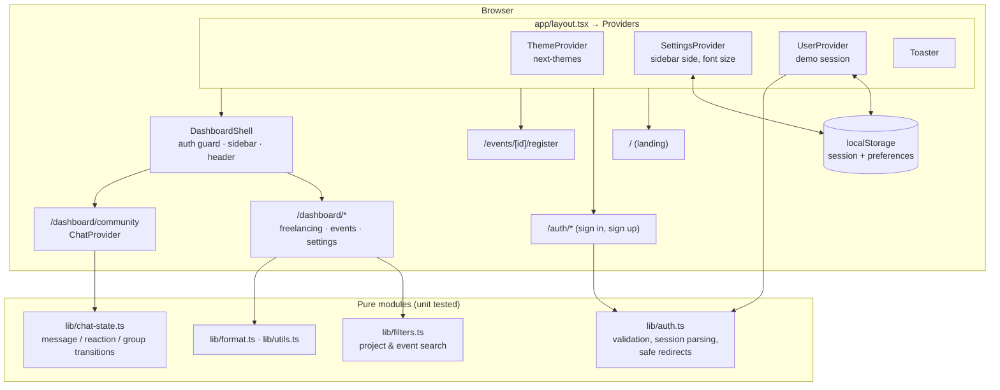

# TechCollab

**Freelancing, tech events and developer communities in one role-aware workspace.**




## Overview

People who work in tech usually juggle several tools: one marketplace to find or post freelance work, another site for meetups and hackathons, and a chat app for their communities. TechCollab puts all three behind one sign-in, and the dashboard adapts to who you are:

- **Freelancers** browse projects, send proposals, keep a portfolio and find events.
- **Clients** post projects, review proposals and host events.
- **Startups** do the same as clients, with copy aimed at finding co-founders and early talent.

> [!NOTE]
> **This is a front-end prototype.** There is no backend yet. Accounts, preferences and chat live in your browser (`localStorage` and in-memory state). Projects, events and statistics are sample data. Every screen and flow works end to end, and the domain logic sits in pure, tested modules so a real API can be added later. See [Known limitations](#known-limitations).

## Contents

- [Screenshots](#screenshots)
- [Features](#features)
- [Tech stack](#tech-stack)
- [Architecture](#architecture)
- [Getting started](#getting-started)
- [Configuration](#configuration)
- [Usage walkthrough](#usage-walkthrough)
- [Scripts](#scripts)
- [Testing](#testing)
- [Code quality](#code-quality)
- [Accessibility & responsiveness](#accessibility--responsiveness)
- [Deployment](#deployment)
- [Project structure](#project-structure)
- [Troubleshooting / FAQ](#troubleshooting--faq)
- [Known limitations](#known-limitations)
- [Roadmap](#roadmap)
- [Contributing](#contributing)
- [License](#license)

## Screenshots

All screenshots are taken from the running app using its built-in sample data.

| Dashboard (light)                                              | Events (dark mode)                                               |
| -------------------------------------------------------------- | ---------------------------------------------------------------- |
|           |      |
| **Find Work (freelancer)**                                     | **Community chat**                                               |
|  |  |

| Sign-up on mobile                                                                                         | Dashboard on mobile (dark)                                                                            |
| --------------------------------------------------------------------------------------------------------- | ----------------------------------------------------------------------------------------------------- |
|  |  |

## Features

**Accounts & onboarding**

- Sign up as a freelancer, client or startup. The role picker works with the keyboard and shows the chosen role.
- Form validation with clear, inline messages (email format, 8+ character password, matching confirmation, terms).
- Demo sign-in with any email and password. If you previously signed up with that email in this browser, your profile is reused.
- Visiting a dashboard page while signed out sends you to sign-in and back again afterwards (`?next=`). Only same-site paths are accepted, so the parameter can't be used for an open redirect.
- Log out from the account menu.

**Freelancing**

- _Find Work_ (freelancers): search by keyword and filter by category and budget (hourly, or fixed-price ranges), with a live result count, an empty state and "Clear filters".
- Submit a proposal for a project, view your proposals and saved projects, and edit your freelancer profile and portfolio.
- _Project Management_ (clients/startups): post a project, see active contracts and proposals, and view basic analytics.

**Events**

- Discover hackathons, workshops, meetups, conferences and more. Search and filter by type, location (including online) and free/paid.
- Register through a quick modal or the full registration page (`/events/[id]/register`).
- Create an event, then manage it: attendee list with bulk select, check-in view, announcements and settings.

**Community**

- Public and private groups plus direct messages: send, edit and delete messages, toggle emoji reactions, create a group (accessible dialog), join or leave groups.
- A group management view with members, settings, moderation and activity tabs.
- "Invite Members" copies a sign-up link to the clipboard.

**Settings & personalisation**

- Edit your profile; name, email and company are saved to your session.
- Light, dark or system theme; sidebar on the left or right; small, default or large text. Saved per browser.
- Deep-linkable tabs everywhere, e.g. `/dashboard/settings?tab=appearance`.

**Polish**

- Every page has a title and description, plus Open Graph tags and an image generated at build time. Custom favicon.
- 404 page, error page and loading skeletons. Toasts confirm actions.
- Security headers on every response.

## Tech stack

| Layer                | Technology                                                                   | Notes                                                                 |
| -------------------- | ---------------------------------------------------------------------------- | --------------------------------------------------------------------- |
| Framework            | [Next.js 15](https://nextjs.org/) App Router                                 | Pages are prerendered statically where possible                       |
| UI library           | React 19                                                                     |                                                                       |
| Language             | TypeScript (strict)                                                          | `tsc --noEmit` runs in `pnpm build` and `pnpm typecheck`              |
| Styling              | Tailwind CSS 3 + CSS variables                                               | Colours defined once in `app/globals.css`, with light and dark themes |
| Components           | [shadcn/ui](https://ui.shadcn.com/) on [Radix UI](https://www.radix-ui.com/) | Accessible primitives (dialog, select, tabs, switch, …)               |
| Icons                | lucide-react                                                                 |                                                                       |
| Theming              | next-themes                                                                  | System, light and dark                                                |
| Testing              | Vitest, Testing Library, jsdom                                               | Unit and integration tests                                            |
| Linting / formatting | ESLint 9 (`next/core-web-vitals`, `next/typescript`), Prettier               |                                                                       |
| Package manager      | pnpm 10                                                                      | Version pinned in `package.json`                                      |

## Architecture



**Design principles**

- **React for wiring, plain TypeScript for rules.** Contexts in `lib/*-context.tsx` stay thin. Validation, (de)serialisation, chat state changes and filtering live in framework-free functions that are tested on their own. Swapping in a real API means replacing the providers, not rewriting the rules.
- **Defensive storage.** Saved sessions and preferences are parsed and checked before use. Corrupted or tampered values are ignored instead of crashing the page, and storage errors (for example in private browsing) are handled gracefully.
- **No hydration surprises.** Preferences are loaded after mount, so the server-rendered HTML and the first client render match.
- **The dashboard guard is a UX convenience, not a security boundary.** Demo auth is client-side only. Once a backend exists, authorisation must be enforced on the server.

**Security headers** (set in `next.config.mjs`): `X-Content-Type-Options: nosniff`, `X-Frame-Options: DENY`, `Referrer-Policy: strict-origin-when-cross-origin`, `Permissions-Policy: camera=(), microphone=(), geolocation=()`. The `X-Powered-By` header is turned off.

## Getting started

### Prerequisites

- **Node.js 20.9 or newer** (developed and tested on Node 22)
- **pnpm 10**: run `corepack enable` and the version pinned in `package.json` will be used

### Installation

```bash
# 1. Clone and enter the project
git clone https://github.com/jeevithg090/JeevsTry.git
cd JeevsTry

# 2. Install dependencies
pnpm install

# 3. (Optional) create a local env file
cp .env.example .env.local

# 4. Start the dev server
pnpm dev
```

Open <http://localhost:3000>.

### Production build

```bash
pnpm build
pnpm start            # serves on http://localhost:3000
pnpm start -p 4000    # or choose another port
```

## Configuration

| Variable               | Required | Default                 | Description                                                                                                                                    |
| ---------------------- | -------- | ----------------------- | ---------------------------------------------------------------------------------------------------------------------------------------------- |
| `NEXT_PUBLIC_SITE_URL` | No       | `http://localhost:3000` | Public base URL of the site. Used for absolute URLs in metadata, such as Open Graph image links. Set it to your production URL when deploying. |

The app needs no secrets or API keys.

## Usage walkthrough

1. **Create an account.** Go to `/auth/signup`, choose _Freelancer_, _Client_ or _Startup_, and fill in the form. Leaving fields empty or mismatching the passwords shows inline errors.
2. **Explore your dashboard.** You land on `/dashboard`, greeted by name. The sidebar changes with your role; for example, clients see _Projects_ and freelancers see _Find Work_.
3. **Find work (freelancer).** Open _Find Work_, type `python` in the search box and the list narrows to one project. Try a term with no matches to see the empty state, then click _Clear filters_.
4. **Post a project (client/startup).** _Create → Post a project_, fill in the form and publish. A toast confirms it and you're taken to _My Projects_.
5. **Register for an event.** _Events → Discover_, filter to _Online_ or _Free_, then click _Register_ on a card.
6. **Host an event.** _Create → Host an event_, then manage attendees at `/dashboard/events/manage/1`.
7. **Chat.** _Community → General Discussion_: send a message, react with an emoji, or create a new group.
8. **Personalise.** _Settings → Appearance_ to switch theme, sidebar side and text size.
9. **Sign out** from the avatar menu. Your session is cleared from this browser.

Handy deep links:

| URL                                       | Opens                              |
| ----------------------------------------- | ---------------------------------- |
| `/dashboard/events?tab=hosting`           | Events you host (clients/startups) |
| `/dashboard/freelancing?tab=my-proposals` | Your proposals (freelancers)       |
| `/dashboard/settings?tab=appearance`      | Theme, sidebar and text size       |
| `/auth/signin?next=/dashboard/community`  | Sign in, then go to Community      |

## Scripts

| Command             | What it does                                           |
| ------------------- | ------------------------------------------------------ |
| `pnpm dev`          | Start the development server with hot reload           |
| `pnpm build`        | Create a production build (also type-checks and lints) |
| `pnpm start`        | Serve the production build                             |
| `pnpm lint`         | Run ESLint over the project                            |
| `pnpm typecheck`    | Run the TypeScript compiler without emitting files     |
| `pnpm test`         | Run the test suite once                                |
| `pnpm test:watch`   | Run tests in watch mode                                |
| `pnpm format`       | Format all files with Prettier                         |
| `pnpm format:check` | Check formatting without writing changes               |

## Testing

```bash
pnpm test
```

The suite uses Vitest with jsdom and Testing Library:

| File                            | Covers                                                                                                                                |
| ------------------------------- | ------------------------------------------------------------------------------------------------------------------------------------- |
| `lib/auth.test.ts`              | Email and form validation, safe parsing of stored sessions, demo user creation, initials, `?next=` redirect sanitising                |
| `lib/chat-state.test.ts`        | Sending, editing and deleting messages; toggling reactions without changing previous state; group membership; finding DMs; unique ids |
| `lib/filters.test.ts`           | Keyword search, category/budget/type/location/price filters, location options                                                         |
| `lib/utils.test.ts`             | `pickAllowed`, `cn`, budget formatting                                                                                                |
| `tests/auth-flow.test.tsx`      | Sign-in/sign-up flows end to end, session restore, corrupted storage, dashboard redirect for signed-out visitors                      |
| `tests/browse-filters.test.tsx` | The _Find Work_ page: search, result count, empty state, clearing filters                                                             |
| `tests/community-chat.test.tsx` | The community page: opening a group, sending, editing (Enter to save) and deleting a message                                          |

## Code quality

- **TypeScript strict mode.** The build fails on type errors.
- **ESLint** with the Next.js Core Web Vitals and TypeScript rule sets. The build fails on lint errors.
- **Prettier** (`printWidth: 120`, no semicolons). Check with `pnpm format:check`.

Before opening a pull request, run:

```bash
pnpm lint && pnpm typecheck && pnpm format:check && pnpm test && pnpm build
```

## Accessibility & responsiveness

- Semantic landmarks (`header`, `nav`, `main`, `footer`), a "Skip to content" link, and a heading structure that doesn't skip levels.
- Every form field and icon-only button has an accessible name. Validation errors are announced and linked to their fields with `aria-describedby`.
- Dialogs (create group, event registration, mobile navigation) trap focus and close with <kbd>Esc</kbd>.
- Visible focus rings. Colour contrast meets WCAG AA in both light and dark themes.
- Layouts checked at phone (375px), tablet (768px) and desktop (1280px) widths with no horizontal scrolling. Tab bars scroll sideways on small screens.

These were checked with axe-core (WCAG 2 A/AA rules plus best practices) on every route in both themes, with zero violations, and by clicking through the main flows in Chromium. Testing with a real screen reader and real devices is still recommended.

## Deployment

TechCollab is a standard Next.js app with no external services.

**Vercel**

1. Import the repository in Vercel. It detects Next.js and pnpm automatically.
2. Set `NEXT_PUBLIC_SITE_URL` to your production URL (for example `https://techcollab.example.com`).
3. Deploy.

**Any Node.js host / container**

```bash
pnpm install --frozen-lockfile
pnpm build
NEXT_PUBLIC_SITE_URL=https://your-domain.example pnpm start -p 3000
```

Put a reverse proxy (nginx, Caddy, or your platform's load balancer) in front for TLS.

> `NEXT_PUBLIC_*` variables are inlined at build time, so set `NEXT_PUBLIC_SITE_URL` **before** running `pnpm build`.

## Project structure

```text
.
├── app/                         Next.js App Router
│   ├── layout.tsx               Root layout: fonts, metadata, skip link, global providers
│   ├── page.tsx                 Landing page
│   ├── icon.svg                 Favicon
│   ├── opengraph-image.tsx      Social preview image generated at build time
│   ├── not-found.tsx            404 page
│   ├── error.tsx                Error page
│   ├── globals.css              Colour tokens (light/dark), base styles, font-size classes
│   ├── auth/                    Account options, sign-in, sign-up
│   ├── events/[id]/register/    Full-page event registration
│   └── dashboard/
│       ├── layout.tsx           Wraps every dashboard page in DashboardShell
│       ├── page.tsx             Overview: stats, activity, quick actions
│       ├── freelancing/         Find Work / Project Management, profile, create-gig, apply
│       ├── events/              Discover, create, manage/[id]
│       ├── community/           Chat, groups/[id] management
│       └── settings/            Profile, account, notifications, billing, appearance
├── components/
│   ├── ui/                      shadcn/ui primitives (button, card, dialog, select, sidebar, …)
│   ├── providers.tsx            Theme, settings and user providers plus toaster
│   ├── dashboard-shell.tsx      Auth guard, sidebar and header layout
│   ├── app-sidebar.tsx          Navigation that adapts to the user's role
│   ├── dashboard-header.tsx     Search, create menu, theme toggle, notifications, account menu
│   ├── header.tsx               Public site header with mobile menu
│   ├── empty-state.tsx          Placeholder for empty lists
│   ├── field-error.tsx          Inline validation message
│   └── page-skeleton.tsx        Loading placeholder
├── hooks/                       use-toast, use-mobile
├── lib/
│   ├── auth.ts                  User model, validation, session parsing, safe redirects
│   ├── chat-state.ts            Pure chat state changes
│   ├── filters.ts               Project and event search/filter logic
│   ├── format.ts, utils.ts      Formatting and small helpers
│   ├── site.ts                  Public site URL
│   ├── user-context.tsx         Session provider (localStorage)
│   ├── settings-context.tsx     Preference provider (localStorage)
│   ├── chat-context.tsx         In-memory chat provider
│   └── mock/chat-data.ts        Sample data for the chat
├── tests/                       Test setup and integration tests
├── docs/screenshots/            README screenshots captured from the running app
├── public/                      Static assets
├── next.config.mjs              Security headers, strict mode
├── eslint.config.mjs            ESLint flat config
├── tailwind.config.ts           Theme tokens, container, animations
└── vitest.config.mts            Test runner config
```

## Troubleshooting / FAQ

**I signed in but my data disappeared after switching browsers.**
Accounts are stored only in the browser's `localStorage`. Each browser (and each private window) has its own demo session.

**The dashboard keeps sending me back to sign-in.**
Your browser may be blocking site storage (strict privacy settings or some private modes). Allow storage for the site, or keep the tab open: the session still works in memory.

**I created a project or event but it isn't in the list.**
There's no backend yet. Creating things confirms with a toast and takes you to the right page, but the new item isn't saved. Lists show sample data.

**`pnpm install` warns about ignored build scripts.**
Only `sharp` is allowed to run install scripts (see `pnpm.onlyBuiltDependencies`). The warning is safe to ignore.

**Port 3000 is already in use.**
Run `pnpm dev -p 3001` or `pnpm start -p 3001`.

**The build fails with type or lint errors.**
That's intentional: the build no longer ignores them. Run `pnpm typecheck` and `pnpm lint` to see the details.

**Fonts fail to download during the build.**
`next/font` fetches Inter from Google Fonts at build time. Build somewhere with internet access.

## Known limitations

- **No backend or persistence**: auth, listings, registrations, proposals and chat are client-side only.
- **Demo auth isn't secure**: any password is accepted and the session is a plain object in `localStorage`.
- **Sample statistics**: dashboard numbers, analytics charts and notification counts are placeholder data.
- **No real-time chat**: messages stay in memory for the current page visit.
- **Payments, billing and email** are UI only.

## Roadmap

- Real authentication (for example Auth.js or a hosted identity service) with server-side session checks.
- An API and database for projects, proposals, events and registrations.
- Real-time chat over WebSockets, with history, typing indicators and unread counts.
- Payments for paid events and project milestones.
- Playwright end-to-end tests for the main journeys.

## Contributing

1. Fork the repository and create a branch, e.g. `feat/short-description`.
2. Make your changes, adding or updating tests for any logic you touch.
3. Run `pnpm lint && pnpm typecheck && pnpm format:check && pnpm test && pnpm build`.
4. Use [Conventional Commits](https://www.conventionalcommits.org/) for commit messages (`feat:`, `fix:`, `docs:` …).
5. Open a pull request describing what changed and how you tested it.

## License

No license has been chosen yet, so all rights are reserved by default. If you'd like others to use or build on this project, consider adding an open-source license such as [MIT](https://choosealicense.com/licenses/mit/).
